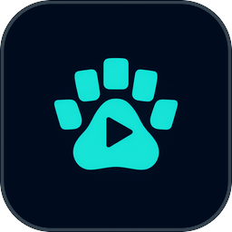
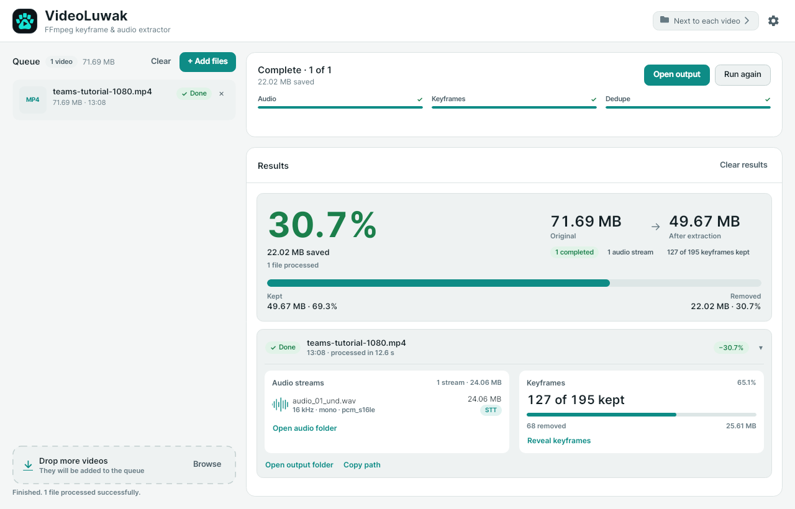
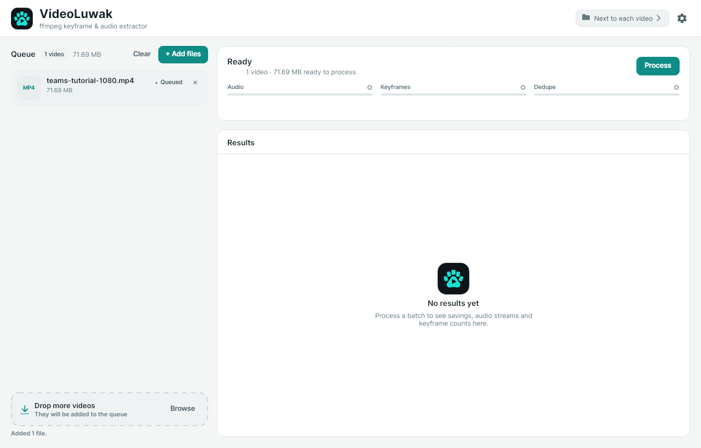
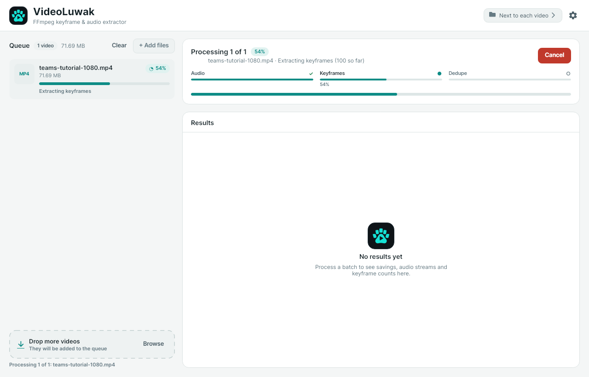
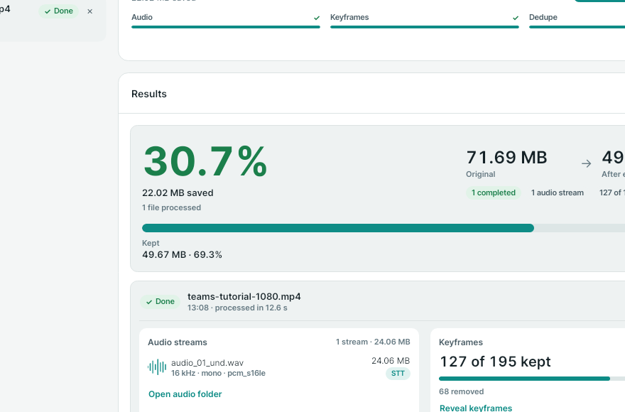
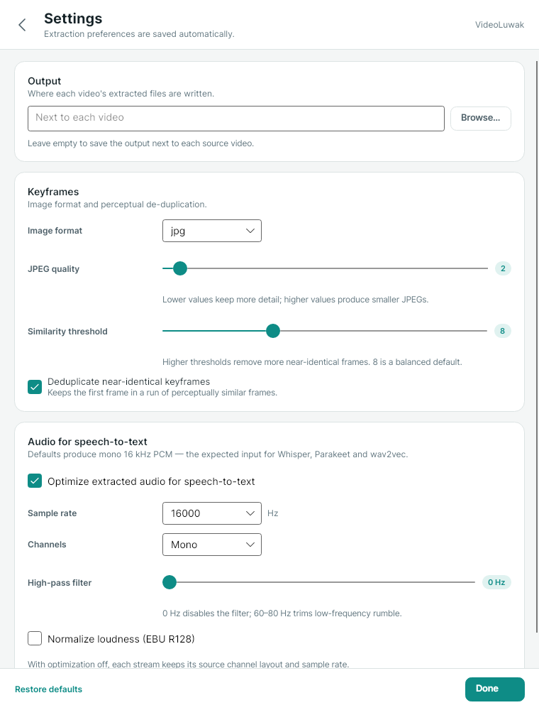

<p align="center">
  
</p>

<h1 align="center">VideoLuwak</h1>

<p align="center">
  <strong>Turn any presentation video into clean audio and just the slides that matter — ready for an LLM.</strong>
</p>

<p align="center">
  <a href="https://github.com/TraberSoftware/VideoLuwak/releases/latest"></a>
  <a href="https://trabersoftware.github.io/VideoLuwak/"></a>
  
  
  <a href="LICENSE"></a>
</p>

<p align="center">
  <a href="https://trabersoftware.github.io/VideoLuwak/">Website</a> ·
  <a href="#screenshots">Screenshots</a> ·
  <a href="#quick-start">Quick start</a> ·
  <a href="#how-it-works">How it works</a> ·
  <a href="#releases-github-actions">Releases</a>
</p>

<p align="center">
  
</p>

VideoLuwak is a small, portable **.NET 10** desktop and command-line utility that pulls the useful
content out of a video using **FFmpeg** — every audio stream as a separate WAV, every keyframe as an
image, and a perceptually de-duplicated copy of those keyframes — then reports how much smaller the
result is.

It is built for one job: **turn a presentation recording into a clean bundle for an LLM.** The audio
is ready for speech-to-text, and the kept frames are the visual content worth sending to a multimodal
model.

### Why VideoLuwak?

- **Audio that transcription models expect.** Every stream becomes a 16-bit PCM WAV, downmixed to
  mono and resampled to 16 kHz by default (Whisper, Parakeet, wav2vec).
- **Fewer frames, not fewer ideas.** A dependency-free 64-bit perceptual hash removes near-identical
  keyframes while preserving chronological order.
- **Inspectable by design.** Every run leaves a machine-readable summary, a per-stream audio
  manifest, and ordinary files you can open, copy, or feed to any downstream tool.
- **Two ways to use it.** Drop files into the desktop app, or script the same engine from the CLI.

## Screenshots

### Queue and live processing

<table>
  <tr>
    <td width="50%">
      
    </td>
    <td width="50%">
      
    </td>
  </tr>
  <tr>
    <td align="center"><sub><b>Queue</b> — drop files, see size, status, and per-file progress.</sub></td>
    <td align="center"><sub><b>Processing</b> — follow the Audio → Keyframes → Dedupe pipeline.</sub></td>
  </tr>
</table>

### Results

The result card is the one-glance answer: how much smaller the output is, which audio streams were
produced, and how many keyframes survived de-duplication.

<table>
  <tr>
    <td width="58%" valign="middle">
      
    </td>
    <td width="42%" valign="middle">
      <h4>What the numbers mean</h4>
      <ul>
        <li><b>30.7% smaller</b> — the extracted bundle versus the source video.</li>
        <li><b>One audio stream</b> — 16 kHz mono PCM, tagged <code>STT</code>.</li>
        <li><b>127 of 195 keyframes kept</b> — 68 near-duplicates removed.</li>
        <li><b>Open output</b> — jump straight to <code>audio/</code>, <code>final_keyframes/</code>, and the JSON summary.</li>
      </ul>
    </td>
  </tr>
</table>

### Settings



## Quick start

1. **Download a release.** Grab the latest Windows, Linux, or macOS build from
   [Releases](#releases-github-actions) — or use the
   [download buttons on the website](https://trabersoftware.github.io/VideoLuwak/#download),
   which always resolve to the newest release. FFmpeg is a system requirement on every platform. On
   Windows, the first processing run shows a notice and installs it automatically with `winget`;
   Linux and macOS users install it with their package manager.
2. **Add a video.** Drop it onto the VideoLuwak window, or run the CLI:
   `VideoLuwak "presentation.mp4" -o ./extracts`.
3. **Use the result.** `audio/` contains one WAV per stream, `final_keyframes/` contains the
   de-duplicated frames, and `processing_result.json` + `audio_streams.json` describe the run.

---

## Website

The product site lives in [`site/`](site/) and is published to
**https://trabersoftware.github.io/VideoLuwak/** by
[`.github/workflows/pages.yml`](.github/workflows/pages.yml).

- **Pure static files.** `index.html`, `styles.css`, and `app.js` — no build step, no dependencies.
- **Automatic deployment.** Every push to `master` that changes `site/**` (or the workflow itself)
  uploads the folder and deploys it with GitHub Pages. Run the workflow manually from the Actions
  tab to redeploy without a new commit.
- **Always links to the latest release.** The download buttons start at `releases/latest` and are
  upgraded in the browser to the exact Windows, Linux, and macOS assets from the GitHub Releases
  API, so no redeploy is needed when a new version ships.
- **Light and dark themes.** The page follows the operating-system preference on first visit and
  remembers an explicit choice.

Preview locally:

```bash
python3 -m http.server 4173 --directory site
# open http://localhost:4173
```

One-time repository setup: **Settings → Pages → Build and deployment → Source: GitHub Actions**.
After that, the workflow publishes on every site change.

---

## How it works

For each input video, VideoLuwak creates `<output base>/<video name>/`, where `<video name>` is the
file name with its final extension removed. If that name ends with a macOS package extension such
as `.app` (for example `Talk.App.mp4`), an ` (output)` suffix is appended so Finder shows an
ordinary folder instead of an application bundle. The folder contains:

```
<video name>/
├── audio/                     # one .wav per audio stream + a manifest
│   ├── audio_01_eng.wav
│   ├── audio_02_spa_Commentary.wav
│   └── audio_streams.json     # source + output format (sample rate / channels / sample format / STT) per stream
├── keyframes/                 # every true keyframe (I-frame) extracted from the video
│   ├── kf_000001.jpg
│   └── ...
├── final_keyframes/           # keyframes kept after perceptual-hash de-duplication
│   └── ...
└── processing_result.json     # machine-readable summary of the run
```

- **Audio** — every audio stream is probed with FFprobe and extracted individually to a
  `pcm_s16le` (16-bit PCM) WAV. By default each WAV is **optimized for speech-to-text** — downmixed
  to **mono** and resampled to **16 kHz** — exactly what Whisper, Parakeet/NVIDIA NeMo and wav2vec
  expect, so no extra conversion step is needed before transcription. This behavior is controlled by
  `ProcessingOptions.SttOptimizeAudio` (default `true`) plus `AudioSampleRate`, `AudioChannels`,
  `AudioHighPassHz` and `AudioNormalizeLoudness`, or via the CLI flags below. When STT optimization
  is disabled the source channel layout and sample rate are preserved (still 16-bit PCM WAV).
  `audio_streams.json` describes the source and the produced output for each stream so you can
  decide which one to keep. Each entry carries the source properties plus the output
  `outputSampleRate`, `outputChannels`, `outputSampleFormat`, `sttOptimized` and a human-readable
  `outputDescription`; the document also has a top-level `sttOptimized` flag and a `target` object
  with the `sampleRate`, `channels` and `sampleFormat` that were applied.
- **Keyframes** — extracted with `ffmpeg -skip_frame nokey` (genuine I-frames only). Files are
  zero-padded (`kf_%06d`) so alphabetical order equals chronological order.
- **De-duplication** — keyframes are enumerated in ascending order; each frame is compared to the
  **previous frame's 64-bit perceptual hash (pHash)**. If the Hamming distance is `<= threshold`
  the frame is dropped. The reference hash **always rolls forward** to the last generated frame —
  even when that frame was removed — so a chain of near-identical frames cannot "drift" past the
  threshold and all collapse to the first one.
- **Summary** — `ProcessingResult` (and `processing_result.json`) report original size, extracted
  audio, keyframes extracted/kept/removed, total output size, and the size reduction percentage.

### pHash without an image library

To stay dependency-light and license-clean, the perceptual hash does not use an image library:
FFmpeg decodes each keyframe to a raw **32×32 grayscale** frame, and a pure C# DCT-II implementation
(`PerceptualHash64`) computes the 64-bit hash (top-left 8×8 DCT coefficients, DC excluded,
median-thresholded).

---

## FFmpeg provisioning

FFmpeg and FFprobe are **system requirements**. VideoLuwak does not bundle them. It resolves the
executables in this order (first hit wins):

1. An explicit path (CLI `--ffmpeg` / `--ffprobe`).
2. `VIDEOLUWAK_FFMPEG` / `VIDEOLUWAK_FFPROBE` environment variables.
3. Next to the executable (or in a `tools/` subfolder).
4. The system `PATH`, plus the standard macOS package-manager locations
   (`/opt/homebrew/bin`, `/usr/local/bin`, `/opt/local/bin`) on macOS.

- **Windows** — if FFmpeg/FFprobe are missing, VideoLuwak shows a first-run notice and attempts an
  automated installation with `winget` (`Gyan.FFmpeg.Essentials`, with the full `Gyan.FFmpeg`
  package as a fallback). If `winget` is unavailable or fails, the app shows manual installation
  instructions. You can also run the setup explicitly with `VideoLuwak --setup-ffmpeg`.
- **Linux** — install FFmpeg with your package manager, for example `sudo apt install ffmpeg`,
  `sudo dnf install ffmpeg`, or `sudo pacman -S ffmpeg`.
- **macOS** — install with Homebrew (`brew install ffmpeg`). Apps opened from Finder or the Dock
  inherit launchd's minimal `PATH`, which omits Homebrew and MacPorts, so VideoLuwak also searches
  their standard install directories automatically.

---

## Build & run

Requires the **.NET 10 SDK**.

```bash
# Build everything (resolves VideoLuwak.slnx)
dotnet build

# Run the CLI
dotnet run --project src/VideoLuwak.App -- "movie.mkv"

# Run the GUI
dotnet run --project src/VideoLuwak.App
```

### Publishing

```powershell
# Windows, single-file portable exe (FFmpeg is installed separately by the user)
dotnet publish src/VideoLuwak.App -c Release -r win-x64 --self-contained true ^
    -p:PublishSingleFile=true -p:IncludeNativeLibrariesForSelfExtract=true
```

```bash
# Linux/macOS (uses the system FFmpeg)
dotnet publish src/VideoLuwak.App -c Release -r linux-x64 --self-contained true \
    -p:PublishSingleFile=true
```

### Releases (GitHub Actions)

The application version is defined **once** in `Directory.Build.props`:

```xml
<Version>1.0.1</Version>
```

That value drives `VideoLuwak --version`, every published assembly, the artifact names, and the
release tag. Bump it before merging a release change into `master`.

`.github/workflows/release.yml` runs only on pushes to `master`:

1. Reads `<Version>` from `Directory.Build.props`.
2. **Blocks the release if the tag `v<Version>` already exists** — no artifacts are built and no
   release is created. Re-pushing `master` without a version bump is therefore a no-op.
3. Runs the test suite with FFmpeg installed.
4. Builds and packages:

   | Platform | Artifact |
   | --- | --- |
   | Windows x64 | `VideoLuwak-<Version>-win-x64.zip` — portable single-file exe (FFmpeg required; first-run setup available) |
   | Linux x64 | `VideoLuwak-<Version>-linux-x64.tar.gz` — self-contained binary (FFmpeg required) |
   | macOS Apple Silicon | `VideoLuwak-<Version>-macos-arm64.dmg` — `.app` bundle (FFmpeg required) |
   | macOS Intel | `VideoLuwak-<Version>-macos-x64.dmg` — `.app` bundle (FFmpeg required) |

5. Creates the `v<Version>` tag at the built commit and a GitHub release. The release notes list
   **every commit since the previous `v*` tag**, with links to each commit and its author. The
   Windows job also exercises the first-run FFmpeg setup and processes a generated test video with
   the published exe.

To publish a new version, bump the manifest and push to `master`:

```bash
# Edit Directory.Build.props: <Version>1.0.2</Version>
git add Directory.Build.props
git commit -m "Release 1.0.2"
git push origin master
```

The version badge at the top of this README is generated from the latest GitHub release.

macOS builds are ad-hoc signed but not notarized; the first launch may require
right-click → **Open**. All platforms require FFmpeg/FFprobe; Windows can install them on first run,
while Linux and macOS use the system package manager.

---

## Command-line usage

```
VideoLuwak [options] <video> [<video> ...]

Options:
  -o, --output <dir>     Base output directory (default: alongside each video)
  -t, --threshold <n>    pHash Hamming-distance threshold for duplicate frames (default 8)
      --format <jpg|png> Keyframe image format (default jpg)
      --quality <1-31>   JPEG quality when --format jpg (default 2, lower = better)
      --no-dedup         Skip the final de-duplicated keyframes folder
      --stt-audio        Downmix/resample audio for speech-to-text (default)
      --no-stt-audio     Keep the source channel layout and sample rate
      --audio-rate <hz>  STT target sample rate (default 16000)
      --audio-channels <n> STT target channel count, >= 1 (default 1)
      --mono             Shorthand for --audio-channels 1
      --stereo           Shorthand for --audio-channels 2
      --highpass <hz>    High-pass filter cutoff, >= 0; 0 disables (default 0)
      --loudnorm         Apply EBU R128 loudness normalization (default off)
      --no-loudnorm      Disable loudness normalization (default)
      --ffmpeg <path>    Explicit FFmpeg executable
      --ffprobe <path>   Explicit FFprobe executable
      --setup-ffmpeg     Install FFmpeg/FFprobe if missing, then exit
  -h, --help             Show help
      --version          Show version
      --gui              Force the graphical interface
```

By default extracted audio is mono 16 kHz 16-bit PCM (what STT models want); use
`--no-stt-audio` to keep the source layout, or the flags above to tune the output.

Examples:

```bash
VideoLuwak movie.mkv
VideoLuwak movie.mkv -o /data/extracts --threshold 6
VideoLuwak a.mp4 b.mkv --format png
VideoLuwak movie.mkv --audio-rate 16000 --highpass 80
VideoLuwak --setup-ffmpeg
```

Exit codes: `0` success, `1` a file failed / FFmpeg missing, `2` usage error.

Double-clicking the application (no arguments) opens the GUI instead.

---

## GUI

The desktop app is organized as a two-pane batch workspace:

- **Header** — the global output folder is a clickable path chip; the gear opens the dedicated
  settings view.
- **Queue** — a compact list with per-file status, live stage/progress, and inline errors. Drop
  files anywhere on the window, use *Add files*, or use the drop strip when the queue is full.
  Queued files can be removed individually; *Clear* empties the queue.
- **Run bar** — one status line, an Audio → Keyframes → Dedupe stepper, batch and per-file
  progress, and state-aware actions: *Process*, *Cancel*, *Open output*, *Run again*.
- **Results** — a single aggregate card (percent smaller, bytes saved, before/after, kept vs.
  removed bar, completed/failed counts) followed by expandable per-file rows. A file row shows
  audio streams, the keyframe kept ratio, and open/copy actions; failed rows show the error and
  diagnostics. Savings are computed from successful files only, so a failed file can never
  inflate the reduction.
- **Settings view** — a dedicated window (gear icon) with output destination, keyframe format,
  JPEG quality, pHash similarity threshold, dedupe, and the audio-for-speech-to-text group
  (sample rate, mono/stereo, high-pass, EBU R128 normalization). Changes are saved automatically
  and restored on the next launch.
- **Status line** — the bottom of the queue reports add/shell errors and run status.
- **First-run setup** — if FFmpeg/FFprobe are missing, the run bar shows a notice. On Windows,
  *Process* starts an automated `winget` installation; on Linux/macOS the app shows the
  package-manager instructions instead.

Settings live at:

- Windows: `%APPDATA%\VideoLuwak\settings.json`
- Linux/macOS: `$XDG_CONFIG_HOME/VideoLuwak/settings.json` (or `~/.config/VideoLuwak/settings.json`)

### Brand assets

The logo lives in `src/VideoLuwak.App/Assets/logo/`:

- `logo-1024.png` — master logo (1024×1024).
- `logo-512.png` … `logo-16.png` — full-logo exports.
- `logo-mark-transparent-512.png` … `-16.png` — cropped paw mark with transparency, used in the header and empty state.
- `logo-mark-square-1024.png` … `-16.png` — tight square app-icon exports.
- `logo.ico` — multi-size Windows icon (16, 20, 24, 32, 40, 48, 64, 96, 128, 256),
  with 32-bit DIB entries for small sizes and PNG entries for large sizes.

The executable icon is embedded via `ApplicationIcon`; on Windows the window/taskbar icon
uses the multi-size ICO so the shell can pick the exact size. Other platforms use the
square PNG icon.

---

## Testing

```bash
dotnet test
```

Unit tests cover the pHash, the de-duplication rolling-reference algorithm, path layout, CLI
parsing, progress parsing and settings. Integration tests generate a real multi-audio video with
FFmpeg and run the full pipeline end-to-end (they no-op when FFmpeg is not installed).

---

## License

VideoLuwak is released under the **[MIT License](LICENSE)**.

FFmpeg and FFprobe are **not bundled**. They are system dependencies with their own licenses; a
build that includes GPL-covered components is GPL, while an LGPL-only build is LGPL. See the
official [FFmpeg legal page](https://ffmpeg.org/legal.html) and
[THIRD_PARTY_NOTICES.md](THIRD_PARTY_NOTICES.md). The Windows first-run setup uses `winget` to
install FFmpeg on the user's machine; VideoLuwak does not redistribute those binaries. FFmpeg is a
trademark of Fabrice Bellard; VideoLuwak is not endorsed by or affiliated with the FFmpeg project.

---

## Project layout

```
src/VideoLuwak.Core   # cross-platform engine: FFmpeg, hashing, pipeline, settings, CLI
src/VideoLuwak.App    # Avalonia app: dual-mode entry point (CLI + GUI)
tests/                # unit + integration tests
scripts/              # macOS DMG packager
site/                 # static product site (GitHub Pages)
.github/workflows     # release automation + Pages deployment
docs/                 # README screenshots
```
